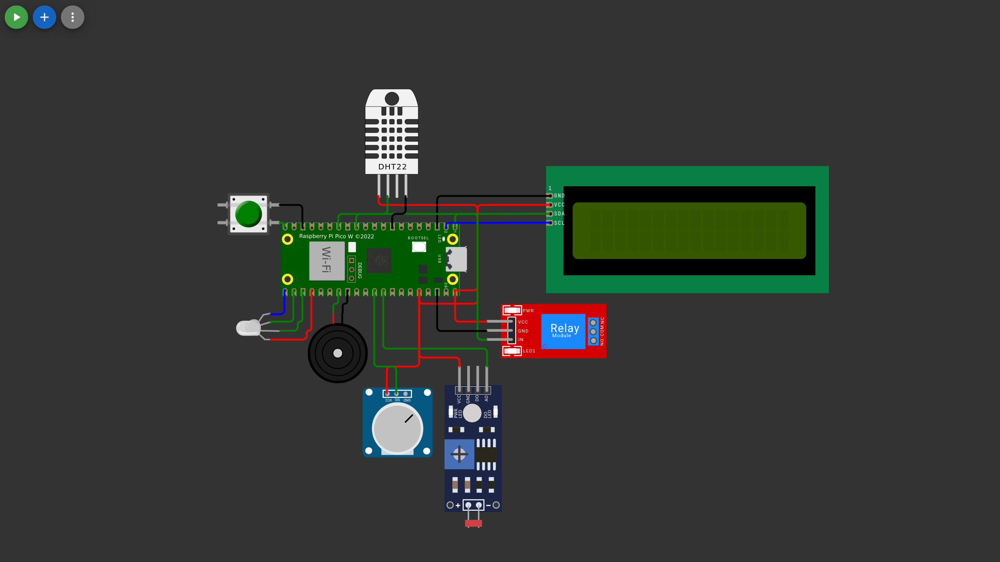

# Cadena de Frío Farmacéutica

Proyecto Final, Desarrollo de Software VIII.

Arles, Gloria, Luis, Juan, Alex.

Monitoreo de nevera de vacunas entre 2 y 8 °C.



| | |
|---|---|
| Placa | Raspberry Pi Pico W en Wokwi |
| Sensores | DHT22, LDR, potenciómetro, botón |
| Actuadores | LED RGB, zumbador, relay, LCD |
| MQTT | HiveMQ |
| Base de datos | MariaDB |
| Nube | Adafruit IO |

## Pines

| Componente | Pin | Uso |
|---|---|---|
| DHT22 | GP9 | Temperatura |
| LDR | GP27 | Puerta |
| Potenciómetro | GP26 | Batería |
| Botón | GP15 | Silenciar |
| LED RGB | GP18, GP17, GP16 | Estado |
| Zumbador | GP21 | Alarma |
| Relay | GP10 | Compresor |
| LCD I2C | GP0, GP1 | Pantalla |

## Flujo

1. Lectura cada 2 s, publica en `ds8/frio/datos`.
2. Fuera de rango pasa a `ALARMA` y publica en `ds8/frio/eventos`. Sobre 8 °C enciende el relay, bajo 2 °C lo apaga.
3. Adafruit IO cada 10 s.
4. Comandos por `ds8/frio/comandos` o Adafruit IO, respuesta en `ds8/frio/ack`.
5. `puente/` guarda todo en MariaDB.

## Estructura

| Carpeta | Contenido |
|---|---|
| `wokwi/` | Pico W y diagram.json |
| `puente/` | MQTT a MariaDB |
| `sql/` | Tablas y consultas |
| `documentos/` | Enunciado, contrato, tareas, capturas |

## Uso

### Base de datos

```
mariadb -u root -e "CREATE USER 'ds8'@'localhost' IDENTIFIED BY 'ds8'; GRANT ALL ON frio.* TO 'ds8'@'localhost';"
mariadb -u root < sql/schema.sql
mariadb -u root < sql/consultas.sql
```

### Puente

```
pip install -r requirements.txt
cd puente
python logger.py
```

### Wokwi

1. Proyecto Pico W con MicroPython.
2. Subir `wokwi/`.
3. Copiar `secretos_ejemplo.py` a `secretos.py` con la cuenta de Adafruit IO.

## Documentos

- [Contrato](documentos/contrato.md)
- [Tareas](documentos/tareas.md)
- [Enunciado](documentos/enunciado.md)
